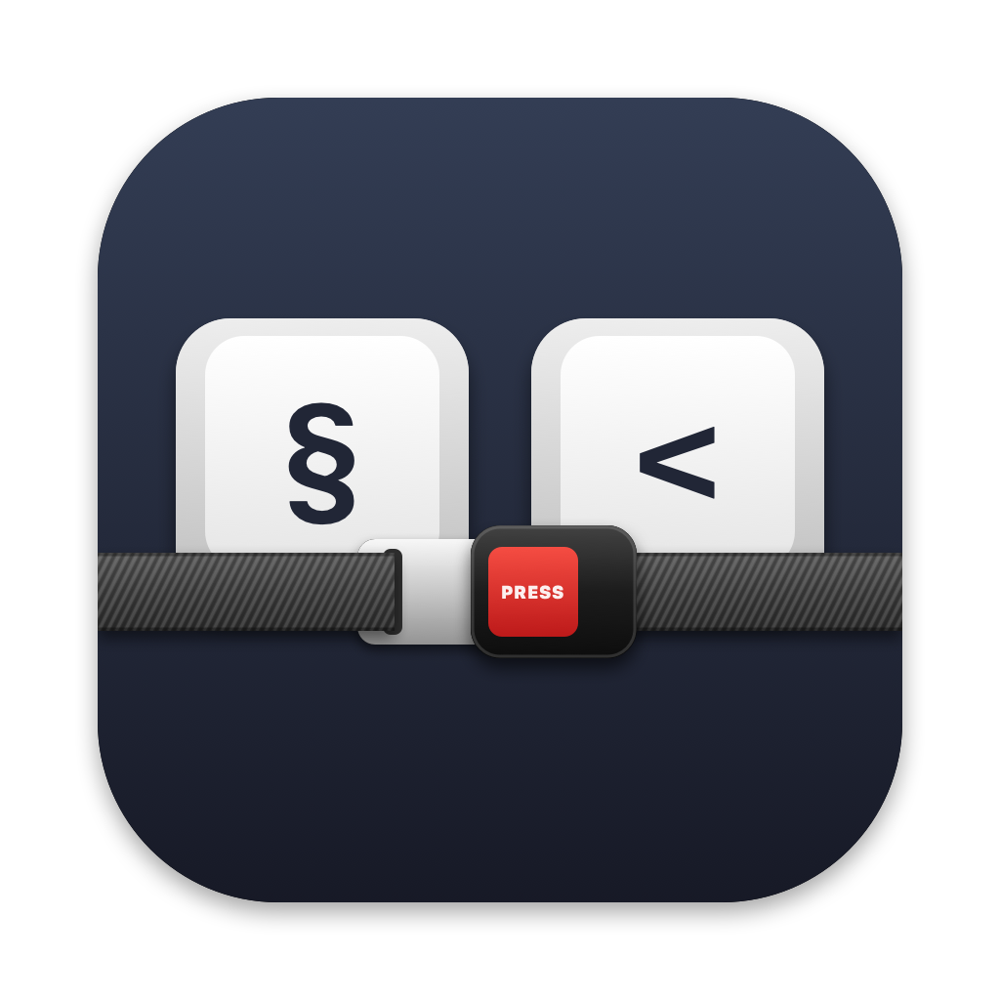

# ISOFix

Keeps **`§`** and **`<`** where they belong on third-party and custom ISO keyboards on macOS.

## The problem

Apple's ISO keyboards send these two keys the opposite way from the USB standard. So for every other ISO keyboard, macOS has to guess whether to swap them. It often guesses wrong (even after Keyboard Setup Assistant), and even when it gets it right, macOS tends to flip it back later. You end up with `§` next to Shift and `<` under Esc. Maddening!

The usual fix is Karabiner-Elements, which is great! But it's also huge overkill for this simple issue: a driver extension and background services grabbing every keystroke you type and sending it back out through a virtual keyboard, all to swap two keys. It also swaps them blindly, so it's wrong whenever macOS happens to get them right.

ISOFix notices when `§` and `<` come out wrong and fixes it for that keyboard. It uses macOS's built-in per-keyboard key remapping (the one `hidutil` uses), with no driver, no root, and no interception of your typing.

## Install

```sh
git clone https://github.com/spacecakes/isofix.git && cd isofix && ./build.sh install
```

Needs macOS 13+ and the Xcode Command Line Tools. Grant **Input Monitoring** when asked.

If you're running Karabiner-Elements, quit it. It takes over your keyboards, so ISOFix can't fix them.

## Usage

Start the app. It runs hidden and starts itself at login. Open it again any time to change its settings.
